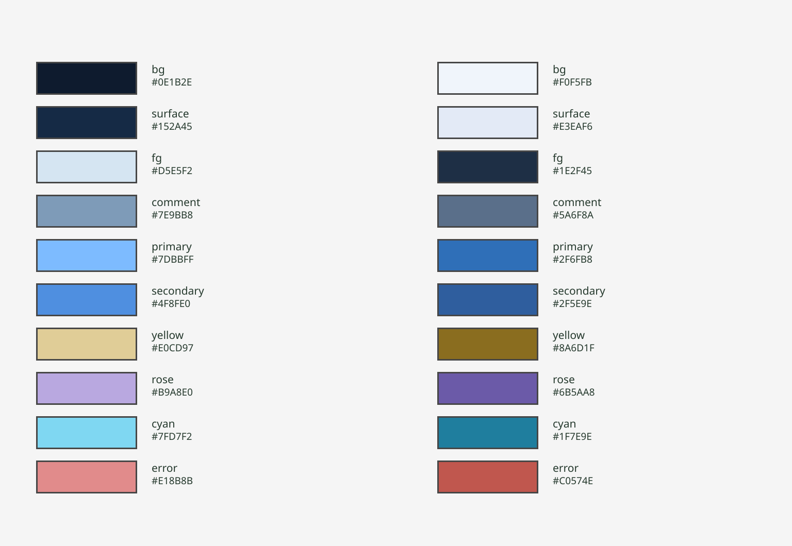

# Bluney Palette

Bluney is a blue-injected theme family — like oceanic but slightly bluer.
Every neutral is hue-shifted toward blue (grays → slate/ice), and every accent
is a blue derivative. Two variants: **Dark** and **Light**.

## WCAG Contrast (measured)

Ratios are foreground/background. WCAG 2.0 AA requires ≥ 4.5:1 for normal text.

| Variant | Pair            | Ratio | Pass AA |
|---------|-----------------|-------|---------|
| Dark    | fg / bg         | 13.43 | yes     |
| Dark    | primary / bg    |  8.58 | yes     |
| Dark    | secondary / bg  |  5.22 | yes     |
| Dark    | error / bg      |  6.81 | yes     |
| Dark    | rose / bg       |  8.02 | yes     |
| Dark    | cyan / bg       | 10.62 | yes     |
| Dark    | yellow / bg     | 10.99 | yes     |
| Dark    | comment / bg    |  5.98 | yes     |
| Dark    | color0 / bg     |  1.16 | no*     |
| Dark    | color8 / bg     |  4.09 | no*     |
| Light   | fg / bg         | 12.38 | yes     |
| Light   | primary / bg    |  4.69 | yes     |
| Light   | secondary / bg  |  5.96 | yes     |
| Light   | error / bg      |  4.97 | yes     |
| Light   | rose / bg       |  5.24 | yes     |
| Light   | cyan / bg       |  5.26 | yes     |
| Light   | yellow / bg     |  5.51 | yes     |
| Light   | comment / bg    |  4.70 | yes     |
| Light   | color0 / bg     |  1.10 | no*     |
| Light   | color8 / bg     |  4.70 | yes     |

\* Every foreground/accent pair in both variants passes AA except the
decorative ANSI "black" (color0), which is intentionally below 4.5:1. Comment
and color8 (bright black) are at/near the cut-off by design — they mark
secondary text, not primary content.

## Dark Variant — `#0E1B2E`

| Role       | Hex       | Notes             |
|------------|-----------|-------------------|
| bg         | #0E1B2E   | deep abyss        |
| surface    | #152A45   | slate lift        |
| fg         | #D5E5F2   | ice               |
| comment    | #7E9BB8   | steel             |
| primary    | #7DBBFF   | blue              |
| secondary  | #4F8FE0   | steel blue        |
| yellow     | #E0CD97   | pale gold         |
| rose       | #B9A8E0   | periwinkle        |
| cyan       | #7FD7F2   | glacier cyan      |
| error      | #E18B8B   | muted red         |

## Light Variant — `#F0F5FB`

| Role       | Hex       | Notes             |
|------------|-----------|-------------------|
| bg         | #F0F5FB   | pale ice          |
| surface    | #E3EAF6   | blue mist         |
| fg         | #1E2F45   | deep navy         |
| comment    | #5A6F8A   | slate             |
| primary    | #2F6FB8   | blue              |
| secondary  | #2F5E9E   | steel blue        |
| yellow     | #7A5F1A   | antique gold      |
| rose       | #6B5AA8   | slate violet      |
| cyan       | #1B6E8A   | lagoon            |
| error      | #AE4A42   | muted red         |

## ANSI 16-Color Table

### Dark

| Var        | Hex       | Notes              |
|------------|-----------|--------------------|
| background | #0E1B2E   | deep abyss         |
| foreground | #D5E5F2   | ice                |
| cursor     | #D5E5F2   | ice                |
| color0     | #16283E   | black (dark slate) |
| color1     | #E18B8B   | red (muted red)    |
| color2     | #7DBBFF   | green (primary)    |
| color3     | #E0CD97   | yellow (pale gold) |
| color4     | #4F8FE0   | blue (steel blue)  |
| color5     | #B9A8E0   | magenta (periwinkle)|
| color6     | #7FD7F2   | cyan (glacier)     |
| color7     | #D5E5F2   | white (ice)        |
| color8     | #5F7E9E   | bright black (steel)|
| color9     | #F0A8A8   | bright red         |
| color10    | #A8D4FF   | bright green       |
| color11    | #EBDFA8   | bright yellow      |
| color12    | #7FA9E8   | bright blue        |
| color13    | #CDBEF0   | bright magenta     |
| color14    | #A8E8F8   | bright cyan        |
| color15    | #FFFFFF   | bright white       |

### Light

| Var        | Hex       | Notes              |
|------------|-----------|--------------------|
| background | #F0F5FB   | pale ice           |
| foreground | #1E2F45   | deep navy          |
| cursor     | #1E2F45   | deep navy          |
| color0     | #E3EAF6   | black (blue mist)  |
| color1     | #AE4A42   | red (muted red)    |
| color2     | #2F6FB8   | green (primary)    |
| color3     | #7A5F1A   | yellow (antique)   |
| color4     | #2F5E9E   | blue (steel)       |
| color5     | #6B5AA8   | magenta (slate-violet)|
| color6     | #1B6E8A   | cyan (lagoon)      |
| color7     | #1E2F45   | white (deep navy)  |
| color8     | #5A6F8A   | bright black (slate)|
| color9     | #D0705F   | bright red         |
| color10    | #4F8FD4   | bright green       |
| color11    | #A08428   | bright yellow      |
| color12    | #5B7FC4   | bright blue        |
| color13    | #8B7FD4   | bright magenta     |
| color14    | #3E9EB8   | bright cyan        |
| color15    | #FFFFFF   | bright white       |

## Recipe

Bluney starts from a blue base and pushes every neutral toward navy/ice —
grays become slate or mist, greens become glacier cyan, reds become soft coral.
It is Greenit's sibling, not a hue swap: the proportions are retuned for blue.
